<div align="center">

<picture>
  <source media="(prefers-color-scheme: dark)" srcset="logo/social/readme-banner-dark.png">
  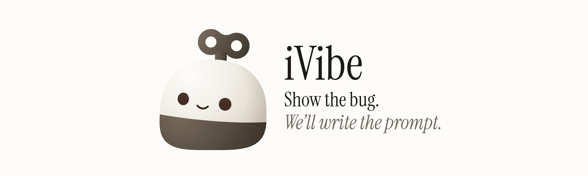
</picture>

<p>
  <a href="https://github.com/nikylogic/ivibe/releases/latest"></a>
  <a href="https://github.com/nikylogic/ivibe/releases"></a>
  <a href="https://github.com/nikylogic/ivibe/actions/workflows/ci.yml"></a>
  <a href="LICENSE"></a>
</p>

<p>
  <a href="https://github.com/nikylogic/ivibe/releases/latest"><b>Download</b></a> ·
  <a href="https://ivibe.tech"><b>Website</b></a> ·
  <a href="https://youtu.be/BAL_gg1cgf8"><b>Demo video</b></a> ·
  <a href="#how-it-works"><b>How it works</b></a> ·
  <a href="#meta-hackathon-checklist"><b>Hackathon checklist</b></a> ·
  <a href="docs/architecture.md"><b>Architecture</b></a> ·
  <a href="CONTRIBUTING.md"><b>Contributing</b></a>
</p>

</div>

**Show the bug and talk it through. iVibe writes the fix prompt, with annotated screenshots as proof, and pastes it straight into Claude Code, Cursor or ChatGPT.**

Press a shortcut, show what's wrong while you explain it, and press it again. iVibe hides secrets on your device, works out what you meant, and pastes the result into the app you were typing in. No report window, no copy-paste.

<div align="center">
  <a href="https://youtu.be/BAL_gg1cgf8"></a>
  <br>
  <sub><b><a href="https://youtu.be/BAL_gg1cgf8">Watch the demo film (2:15)</a></b>: the real app, making live Meta model calls.</sub>
</div>

<div align="center">
  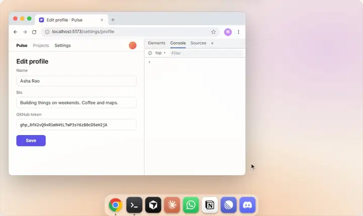
  <br>
  <sub>A recording of the interactive demo at <a href="https://ivibe.tech">ivibe.tech</a>. The website draws the desktop in it, so try it there or download the real app.</sub>
</div>

## You say it, iVibe pastes it

These are the examples from the website demo.

**Fix.** You show the broken page and say:

> I change my bio and hit Save, and nothing happens. The console says it can't read map. It should save and show a toast.

iVibe pastes this into your coding agent, with marked-up screenshots:

```text
Save on Edit profile does nothing

Expected: saving shows a "Saved" toast and keeps the new bio.
Actual: no request is sent. Console: TypeError: Cannot read properties of
undefined (reading 'map') at saveProfile (ProfileForm.tsx:41).
```

**Prompt.** You ramble:

> Uh, so I want, like, a dark mode toggle. It should remember my choice. Oh and, um, follow the system setting by default, I guess.

iVibe pastes a prompt that an AI can act on:

```text
Add a dark mode toggle

Goal: Let people switch between light and dark themes.
Requirements:
- Follow the system setting by default
- Remember the choice across visits
Done when: The choice survives a reload
```

**Dictate.** You talk:

> Hey Asha, um, the demo is, uh, the demo is ready for tomorrow. So, like, let me know what you think.

iVibe pastes what you meant to say:

> Hey Asha, the demo is ready for tomorrow. Let me know what you think!

## See it

<table>
  <tr>
    <td width="33%">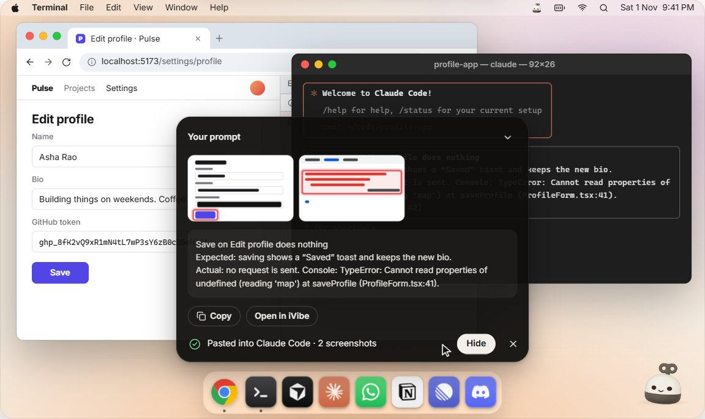</td>
    <td width="33%">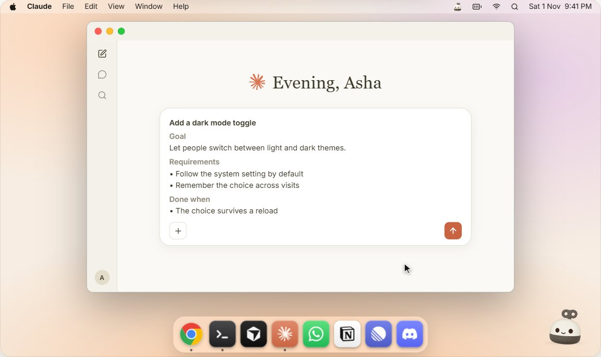</td>
    <td width="33%">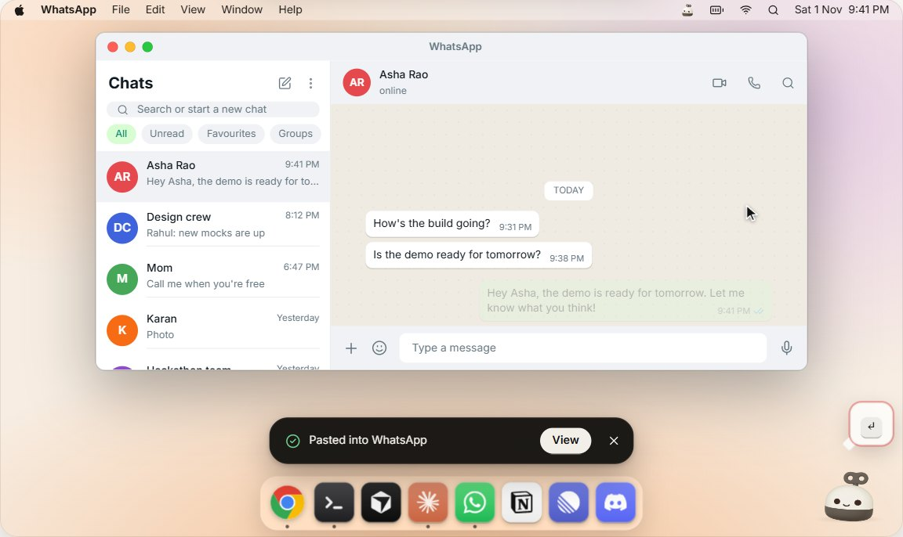</td>
  </tr>
  <tr>
    <td align="center"><b>Fix</b></td>
    <td align="center"><b>Prompt</b></td>
    <td align="center"><b>Dictate</b></td>
  </tr>
</table>

<sub>Scenes from the website's interactive demo.</sub>

**The real desktop app**

<table>
  <tr>
    <td width="50%">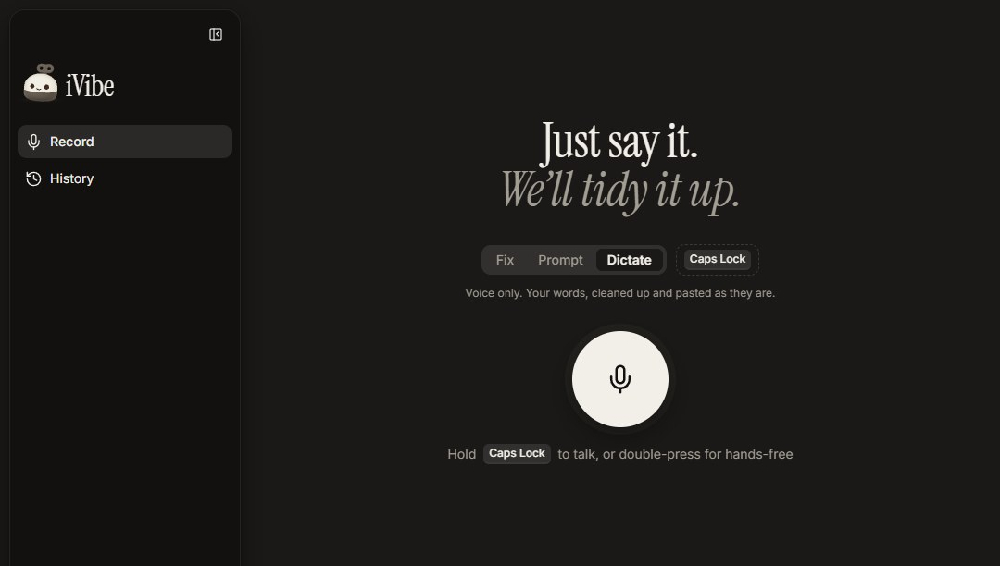</td>
    <td width="50%">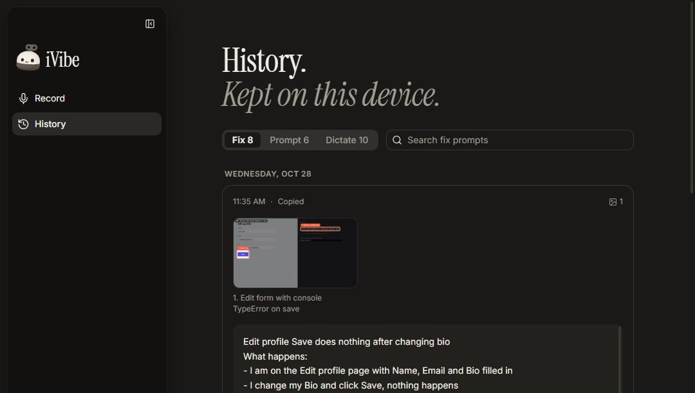</td>
  </tr>
  <tr>
    <td colspan="2">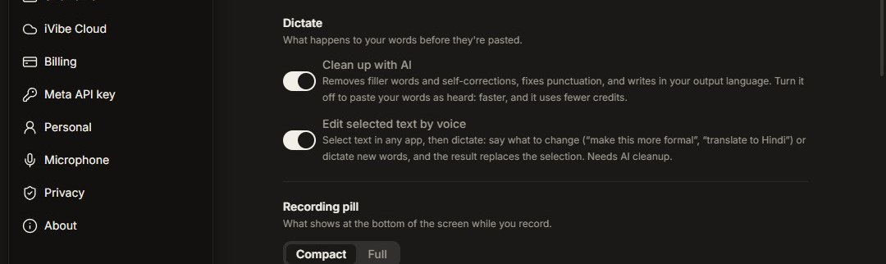</td>
  </tr>
</table>

<sub>Windows screenshots of the app. History shows sample data.</sub>

<details>
<summary><b>On a phone, the website tells the story in steps</b></summary>
<br>
<p align="center">
  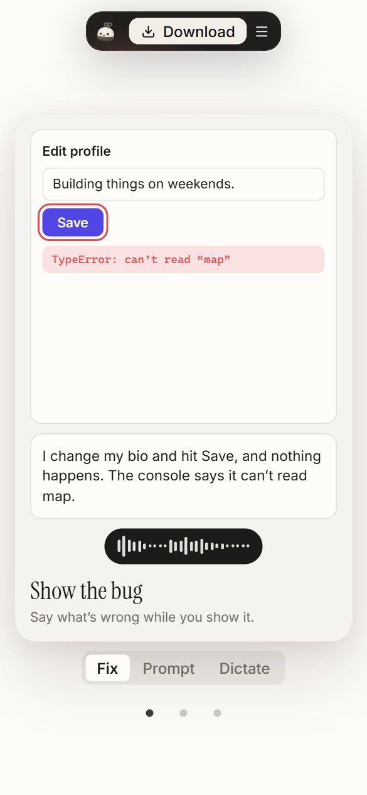
  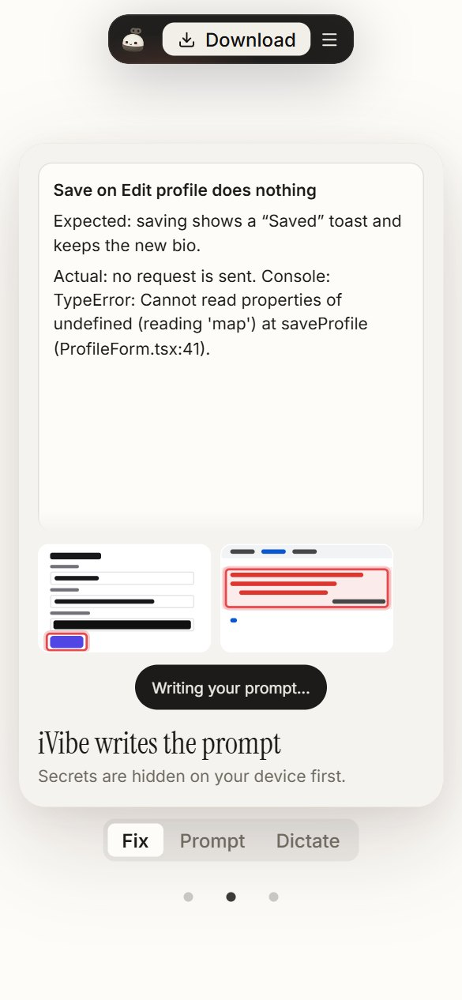
  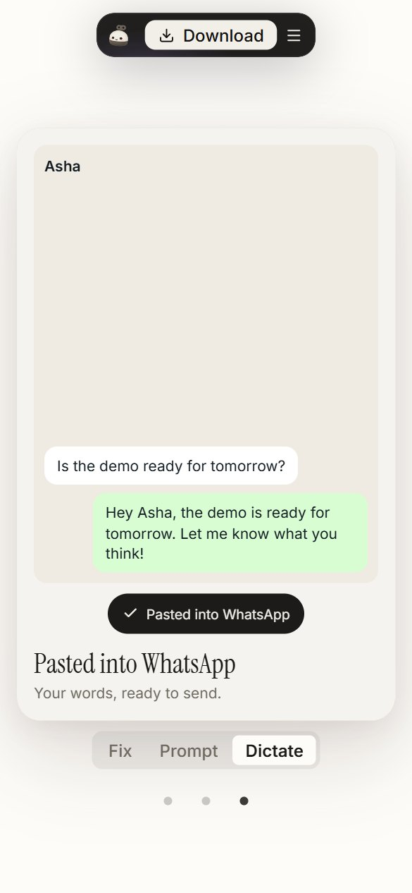
</p>
</details>

<details>
<summary><b>The website</b></summary>
<br>
<a href="https://ivibe.tech">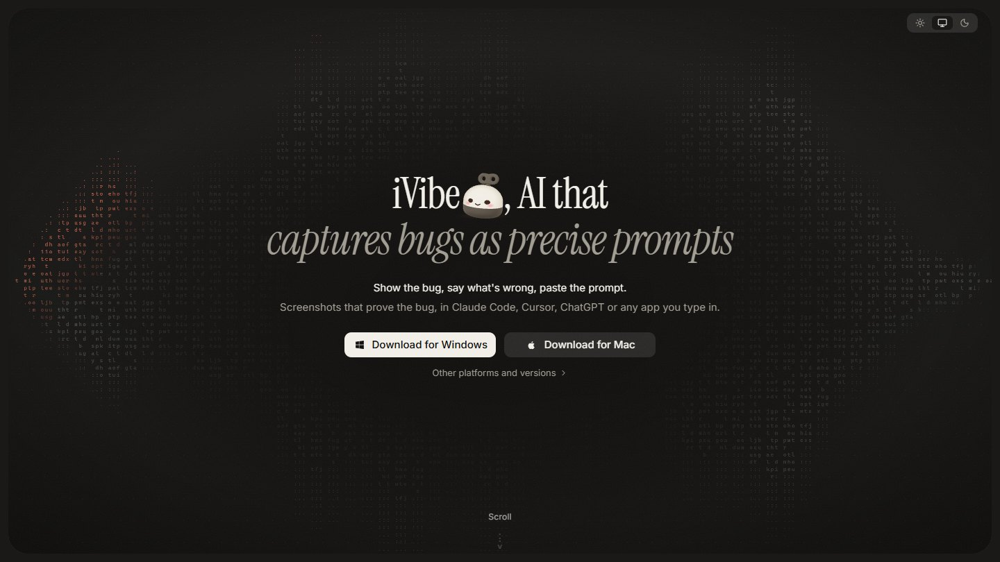</a>
</details>

## Download

iVibe 0.1.5 is out for Windows, macOS and Linux. Get it from the [latest release](https://github.com/nikylogic/ivibe/releases/latest):

| Your computer                         | File                                    |
| ------------------------------------- | --------------------------------------- |
| Windows 10 or 11                      | `iVibe-Setup-<version>.exe`             |
| Mac with Apple silicon (M1 and later) | `iVibe-<version>-mac-arm64.dmg`         |
| Mac with Intel                        | `iVibe-<version>-mac-x64.dmg`           |
| Linux (Ubuntu, Debian)                | `iVibe-<version>-linux-amd64.deb`       |
| Linux (any)                           | `iVibe-<version>-linux-x86_64.AppImage` |

The installers aren't code-signed yet, so your computer asks once before opening iVibe:

- **Windows:** if SmartScreen says "Windows protected your PC", click **More info**, then **Run anyway**.
- **macOS:** the quickest way is one line in Terminal, which installs the latest version into Applications and opens it, with no security prompt:

  ```sh
  curl -fsSL https://raw.githubusercontent.com/nikylogic/ivibe/main/scripts/install-mac.sh | bash
  ```

  Or open the `.dmg` and double-click iVibe: it offers to move itself to Applications. If macOS says it can't verify iVibe, open **System Settings → Privacy & Security** and click **Open Anyway**.

- **Linux:** `sudo apt install ./iVibe-<version>-linux-amd64.deb`, or `chmod +x` the AppImage and run it.

iVibe keeps itself up to date. On Windows and Linux it downloads updates in the background and installs them when you restart; on macOS it tells you when a new version is out.

## Three modes

| Mode        | You give it              | It pastes                                                                         | Windows              | macOS               | Linux                |
| ----------- | ------------------------ | --------------------------------------------------------------------------------- | -------------------- | ------------------- | -------------------- |
| **Fix**     | Your screen + your voice | A fix prompt for your coding agent, with annotated screenshots that prove the bug | `Ctrl` + `Caps Lock` | `⌃` + `⌥` + `Space` | `Ctrl` + `Alt` + `F` |
| **Prompt**  | Your voice               | A clear, structured prompt from what you rambled                                  | `Alt` + `Caps Lock`  | `⇧` + `⌥` + `Space` | `Ctrl` + `Alt` + `P` |
| **Dictate** | Your voice               | Your own words, cleaned up: no "um", no false starts                              | Hold `Caps Lock`     | `⌥` + `Space`       | `Ctrl` + `Alt` + `D` |

Every shortcut can be changed in Settings. On Windows, hold `Caps Lock` to talk, or double-press it for hands-free. Results land where you were typing: screenshots are pasted as images into chat apps and Claude Code, and as file paths into other terminal agents. If you switched apps meanwhile, the result waits on the clipboard and pastes into the next text field you click, or with `Ctrl` + `Alt` + `V`.

Fix and Prompt record for up to 60 seconds, and Dictate for up to 5 minutes. In Dictate you can also select text in any app and say what to change, such as "make this more formal" or "translate to Hindi".

## Plans

| Plan                  | What you get                                                                                                          | Price      |
| --------------------- | --------------------------------------------------------------------------------------------------------------------- | ---------- |
| **Your own Meta key** | Everything. Recordings go from your device straight to Meta, billed to your Meta account.                             | Free       |
| **iVibe Cloud trial** | Sign in with Google or GitHub and get 50 free credits, no key needed.                                                 | Free       |
| **iVibe Pro**         | 400 credits a month, no key needed, plus end-to-end encrypted backups of your history. Credits reset at each renewal. | $8 / month |

A credit is one cent of Meta usage. A dictation costs a fraction of a credit and a Fix report a few credits.

## How it works

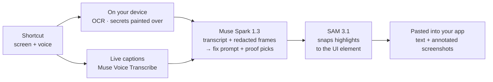

1. **Record.** A shortcut captures the screen under your cursor and your microphone. Captions appear as you talk.
2. **Protect.** Every keyframe is read with on-device OCR (PP-OCRv5). API keys, tokens, `.env` lines and password managers are painted over before a frame can leave the recorder.
3. **Write.** One Muse Spark call reads your narration, the redacted keyframes and their text, and returns the prompt and which frames prove the bug. Prompts are built from layers: fixed rules, the mode, the app you're pasting into, and what you told iVibe about yourself.
4. **Prove.** SAM 3.1 snaps each highlight to the exact button or error; the screenshots are annotated on your device.
5. **Paste.** iVibe pastes into the app you were in, each screenshot after the sentence about it, and keeps a copy in History.

Fix results were accurate in my hands-on testing. A full Fix prompt with marked screenshots takes about 14 seconds on average.

## Built on Meta's models

| Job                                                             | Model                 |
| --------------------------------------------------------------- | --------------------- |
| Write the fix prompt, structured prompt or cleaned-up dictation | Muse Spark 1.3        |
| Live captions and the narration transcript                      | Muse Voice Transcribe |
| Snap proof highlights to the UI element                         | SAM 3.1               |

All of this runs on the Meta Model API, and Muse Spark calls are sent with `store: false`. Runs on your own key and on Pro use `muse-spark-1.3`. Free trial runs use `muse-spark-1.3-contributor`, and Meta may use those requests to improve its models; iVibe tells you this when the trial starts. Muse Spark Open (an open-weight engine for iVibe Cloud) and Muse Wonder (optional deep analysis) are planned, not shipped.

I also used Muse Code to build iVibe, for coding, planning and automated testing. See the [Muse Code log](docs/muse-code-log.md). iVibe also pastes into Muse Code directly, with screenshots as real images.

## Privacy

- **Secrets are hidden on your device.** Only redacted frames and your narration are sent for analysis. [`packages/redact`](packages/redact) has its own tests, and the app's developer self-test records a fake app showing a planted GitHub-style token, to exercise OCR and redaction end to end.
- **The free trial is the exception on training.** Meta may use trial requests to improve its models (see [above](#built-on-metas-models)). Use your own key or Pro to avoid that.
- **Your key stays yours.** A Meta API key is encrypted with your system keychain and used only by the app's main process.
- **History stays on your device.** The last 200 results and their screenshots are kept locally, can be turned off, and can be cleared in Settings.
- **Backups are end-to-end encrypted.** Pro backups are encrypted on your device with a recovery key that only you hold; iVibe can't read them.

## Meta hackathon checklist

Every rule from the [Meta AI Developer Hackathon participant guide](https://cerebralvalley.ai/e/meta-ai-developer-hackathon/details), and where iVibe stands. Checked **Nov 4, 2026**. Unticked boxes aren't done yet.

**The build**

| Status | Rule                                                 | Where iVibe stands                                                                                                                                                                                                                         |
| ------ | ---------------------------------------------------- | ------------------------------------------------------------------------------------------------------------------------------------------------------------------------------------------------------------------------------------------ |
| ✅     | Fits a problem statement                             | **Build for Your World**: a tool for people who build with AI and lose time describing bugs and ideas to it                                                                                                                                |
| ✅     | Uses Meta's models                                   | Muse Spark 1.3 ([`responses.ts`](packages/engine/src/responses.ts)), Muse Voice Transcribe ([`transcribe.ts`](packages/engine/src/transcribe.ts)) and SAM 3.1 ([`proof.ts`](packages/engine/src/proof.ts)), all through the Meta Model API |
| ✅     | Public repository                                    | This repository, public under AGPL-3.0                                                                                                                                                                                                     |
| ✅     | Teams of up to 4, solo allowed                       | Solo                                                                                                                                                                                                                                       |
| ✅     | New work, built during the event                     | First commit Oct 27, 2026, the day building opened. The [full commit history](https://github.com/nikylogic/ivibe/commits/main) is public                                                                                                   |
| ✅     | Judges can tell what was built during the event      | All of it: every commit and [release](https://github.com/nikylogic/ivibe/releases) is dated inside the build window                                                                                                                        |
| ✅     | Not on the anti-project list                         | Not medical advice, basic RAG, a simple image analyzer, an education chatbot, a job screener, a nutrition coach, a personality analyzer, a sports coach or political. It's a desktop developer tool                                        |
| ✅     | Doesn't break legal, ethical or platform policies    | Secrets are removed on the device, the trial's data use is disclosed, and the [privacy section](#privacy) says what leaves your computer                                                                                                   |
| ✅     | Only uses code, data and assets it has the rights to | The dependency license check in [`scripts/`](scripts/) passes. The demo video is edited outside this repo with Remotion, under [its license](https://www.remotion.dev/docs/license)                                                        |

**The submission** (due Nov 4, 2026, 9:00 PM EST, which is Nov 5, 7:30 AM IST)

| Status | Rule                                                     | Where iVibe stands                              |
| ------ | -------------------------------------------------------- | ----------------------------------------------- |
| ✅     | Three-minute demo video of what was built                | Finished, 2:15 long                             |
| ✅     | The demo only shows features built during the hackathon  | Everything in the film was built from Oct 27 on |
| ✅     | Video link opens for anyone                              | [Watch the demo](https://youtu.be/BAL_gg1cgf8)  |
| ✅     | Submitted on the Cerebral Valley platform, once per team | Submitted Nov 4, 2026                           |
| ✅     | Representative chosen, and everyone on the team listed   | Solo, Nikhil P is listed on the form            |
| ✅     | Repository still public at submission                    | Public, rechecked Nov 4                         |

**Optional extras**

| Status | Prize          | Where iVibe stands                                                             |
| ------ | -------------- | ------------------------------------------------------------------------------ |
| ✅     | Most Viral     | Entered with [this X post](https://x.com/hiNikhilP/status/2117854698946580605) |
| ⬜     | Community Vote | Winner named on Nov 16                                                         |

<details>
<summary><b>How iVibe lines up with the judging rubric</b></summary>
<br>

| Criterion                     | Weight | What to look at                                                                                                                                                                                                        |
| ----------------------------- | ------ | ---------------------------------------------------------------------------------------------------------------------------------------------------------------------------------------------------------------------- |
| Impact                        | 30%    | A real, installable app for three operating systems ([releases](https://github.com/nikylogic/ivibe/releases)), with a free plan                                                                                        |
| Use of Meta AI tooling        | 25%    | Three Meta models in one pipeline, each doing a different job: voice, writing and vision ([how it works](#how-it-works)). Muse Code was used for coding, planning and automated testing ([log](docs/muse-code-log.md)) |
| Technical depth and execution | 20%    | On-device OCR and redaction, proof screenshots, encrypted backups and automatic updates. Decisions are in [docs/architecture.md](docs/architecture.md)                                                                 |
| Demo                          | 25%    | The [interactive demo](https://ivibe.tech) is live, and the [2:15 demo film](https://youtu.be/BAL_gg1cgf8) shows the real app making live Meta calls                                                                   |

</details>

<details>
<summary><b>Hackathon timeline</b></summary>
<br>

| Date (2026)        | What happens                                |
| ------------------ | ------------------------------------------- |
| Oct 27 – Nov 4     | Building. iVibe's first commit is on Oct 27 |
| Nov 4, 9:00 PM EST | Submissions close                           |
| Nov 5 – 8          | Judging                                     |
| Nov 9, 12:00 PM ET | Closing, with the top 10 (5 per track)      |
| Nov 16             | Community vote winner                       |

</details>

## Status

Updated **Nov 4, 2026**. The latest release is [0.1.5](https://github.com/nikylogic/ivibe/releases/latest). iVibe is being built in public for the [Meta AI Developer Hackathon](https://cerebralvalley.ai/e/meta-ai-developer-hackathon/details) (Oct 27 – Nov 4, 2026). The full breakdown is in [docs/architecture.md](docs/architecture.md).

**Shipped**

- [x] Fix, Prompt and Dictate, with live captions, personal settings and per-mode shortcuts
- [x] On-device OCR and secret redaction, annotated proof screenshots with SAM 3.1
- [x] Paste into the app you were in, click-to-paste and History
- [x] Installers for Windows, macOS and Linux, with automatic updates
- [x] iVibe Cloud: Google and GitHub sign-in, free trial credits, iVibe Pro and encrypted backups
- [x] [ivibe.tech](https://ivibe.tech): website, docs and an interactive demo for desktop and phone

**Being verified by hand**

- [ ] macOS and Linux on real machines (they build and pass tests in CI)
- [ ] Image paste into Claude Code and ChatGPT (text paste is confirmed)

**Next**

- [ ] A repeatable evaluation suite with published numbers
- [ ] Code signing for Windows and macOS
- [ ] After the hackathon: Vibes, where everything is a vibe, even Fix, Prompt and Dictate, and you can describe a new one instead of coding it ([plan](docs/vibes-and-prompts.md))
- [ ] Then: the note taker, built as a vibe

## Development

**Prerequisites:** Node.js 24+ and pnpm 12+.

```bash
git clone https://github.com/nikylogic/ivibe.git
cd ivibe
pnpm install
pnpm ocr:fetch    # download the on-device OCR models (13 MB, hash-checked)
pnpm check        # lint, format check, typecheck, tests and the dependency license check
pnpm --filter @ivibe/desktop dev   # run the desktop app, with its own profile; F12 opens DevTools
pnpm --filter @ivibe/desktop lab   # every screen and state in a browser, with pretend data
```

Add your Meta Model API key in the app under **Settings → Meta API key**. The experiments in [`spikes/`](spikes/) read it from `.env` instead: copy `.env.example` to `.env`, set `META_API_KEY`, then for example:

```bash
pnpm spike spikes/meta/s10-models.ts
```

**Releasing:** set the version in `apps/desktop/package.json`, commit, and push a matching tag (`git tag -a v0.1.1 -m "iVibe 0.1.1" && git push origin v0.1.1`). GitHub Actions builds every installer into a draft release; publishing the draft is what the app's updater sees.

### Repository layout

```text
apps/desktop   Electron app: recorder, pill, app window, tray, updater, OS helpers
apps/api       iVibe Cloud on Cloudflare Workers: sign-in, credits, Pro billing, backups
apps/web       ivibe.tech: the website, docs, blog and interactive demo
apps/demo-bug  A small React app with a planted bug, for demos
packages/      capture · vision · ocr · redact · encode · imageops · bundle · agent · ui · config · types · engine (Meta API, prompts, proof)
logo/          every logo file, generated from one mascot drawing (logo/README.md)
spikes/        experiments that verify API and platform facts before building on them
docs/          architecture, spike results, the Vibes and prompts plan, README images
scripts/       repository tooling (OCR model download, dependency license check)
```

Every package's role and the decisions behind it are in [docs/architecture.md](docs/architecture.md); spike results are in [docs/spikes.md](docs/spikes.md).

## Contributing

Contributions are welcome. Please read [CONTRIBUTING.md](CONTRIBUTING.md) and the [Code of Conduct](CODE_OF_CONDUCT.md). Contributors sign a [Contributor License Agreement](CLA.md) once, on their first pull request.

Found a security issue? Please report it privately; see [SECURITY.md](SECURITY.md).

## License

iVibe is free and open-source software, licensed under the [GNU Affero General Public License v3.0](LICENSE).

Want to modify iVibe or embed it in a product without the AGPL's obligations? [Commercial licenses](COMMERCIAL.md) are available.

The iVibe name and logo are not covered by the code license; see [TRADEMARKS.md](TRADEMARKS.md).

---

<div align="center">
<sub>Built for the Meta AI Developer Hackathon. iVibe is an independent project and is not affiliated with or endorsed by Meta.</sub>
</div>
