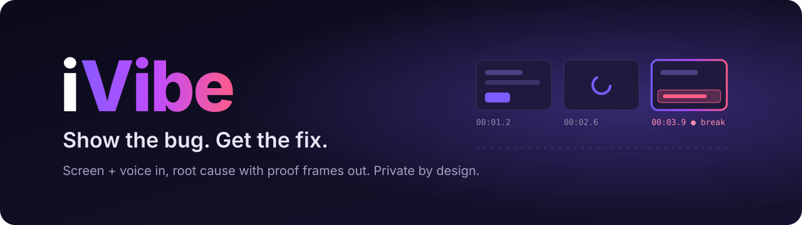
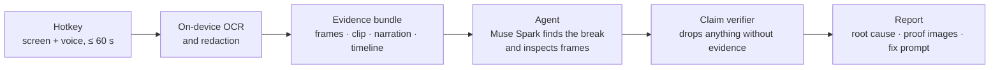

<div align="center">



<p>
  <a href="https://github.com/nikylogic/ivibe/actions/workflows/ci.yml"></a>
  <a href="LICENSE"></a>
  
  
  
</p>

<p>
  <a href="https://ivibe.tech"><b>Website</b></a> ·
  <a href="docs/architecture.md"><b>Architecture</b></a> ·
  <a href="#roadmap"><b>Roadmap</b></a> ·
  <a href="CONTRIBUTING.md"><b>Contributing</b></a>
</p>

</div>

**iVibe turns a 60-second screen recording with your voice into a correct bug explanation, proof images and a fix prompt ready to paste into Cursor, Claude or ChatGPT.**

Press a hotkey, show the bug while you talk about it, press it again. iVibe redacts secrets on your device, finds the exact moment things broke, explains why, and backs every claim with a frame and a timestamp.

> [!NOTE]
> iVibe is being built in public for the [Meta Global AI Developer Hackathon](https://cerebralvalley.ai/e/meta-ai-developer-hackathon) (Oct 27 – Nov 4, 2026). The first release is planned for **Nov 4, 2026**. Star or watch the repo to follow along.

## Why iVibe

Most bugs aren't a single moment. You click **Save**, a spinner turns, nothing happens, and three seconds later an error appears in the console. A screenshot shows one of those moments; an AI coding tool needs all of them, in order, with the exact error text.

New developers feel this the most: they don't yet know which error matters, which moment to capture or what context the AI needs. iVibe watches the whole sequence for them.

|                                           | Screenshot + chat | Screen recorder | **iVibe** |
| ----------------------------------------- | :---------------: | :-------------: | :-------: |
| Captures the sequence, not one moment     |         –         |        ✓        |   **✓**   |
| Finds the break moment automatically      |         –         |        –        |   **✓**   |
| Copies error text exactly (OCR)           |         –         |        –        |   **✓**   |
| Redacts API keys and tokens before upload |         –         |        –        |   **✓**   |
| Every claim cites a frame and timestamp   |         –         |        –        |   **✓**   |
| Writes a fix prompt for your AI tool      |         –         |        –        |   **✓**   |

## How it works



1. **Record.** A global hotkey records your screen and microphone for up to 60 seconds.
2. **Protect.** Every frame is read with on-device OCR. Anything that looks like a key, token or `.env` line is covered with an opaque box before it can be encoded or uploaded.
3. **Analyze.** An agent built on Meta's Muse Spark reads the timeline, finds candidate break moments, zooms into frames and searches the OCR text.
4. **Verify.** Every claim must cite a frame, an OCR line or a moment in your narration. Claims that don't resolve are dropped. Error messages are copied from OCR, never retyped by the model.
5. **Ship the fix.** You get a plain-English explanation, "what to check next", 2–3 highlighted proof images and a structured prompt for Cursor, Claude or ChatGPT.

## Privacy by design

These are the guarantees v0.1 is built around; the [roadmap](#roadmap) shows progress.

- **Redaction happens on your device**, in the desktop app and in the browser recorder. Only a redacted frame type can be encoded or uploaded, and a CI leak test fails the build if a planted secret ever reaches an upload.
- **Bring your own key, free forever.** With your own Meta Model API key, recordings go from your device straight to Meta. Our servers never see the key or the recording.
- **Nothing is kept.** Cloud runs delete their files after the report is delivered (desktop) or after 24 hours (web).
- **No training on your recordings.** iVibe only calls models whose inputs are not used for training; the allowlist is enforced in code and tested in CI.

## Built on Meta's models

| Job                                                               | Model                           |
| ----------------------------------------------------------------- | ------------------------------- |
| Agent: find the break moment, inspect frames, form the root cause | Muse Spark 1.3 (Meta Model API) |
| Open-weight engine for iVibe Cloud                                | Muse Spark Open (via Baseten)   |
| Narration with turn timestamps, including mixed Hindi and English | Muse Voice Transcribe           |
| Proof highlights on the chosen frames                             | SAM 3.1                         |
| Optional deep analysis                                            | Muse Wonder                     |

## Two ways to use it

|                         | **Bring your own key**      | **iVibe Cloud**                                    |
| ----------------------- | --------------------------- | -------------------------------------------------- |
| Price                   | Free forever                | Credits: free starter credits, then plans or packs |
| AI billing              | Your Meta Model API account | Included in credits                                |
| Where the analysis runs | On your device              | On iVibe's servers, on the redacted bundle only    |
| Setup                   | Paste your key once         | Sign in with GitHub or Google                      |

## Platforms

|             | Windows   | macOS                       | Linux             |
| ----------- | --------- | --------------------------- | ----------------- |
| Desktop app | ✓ (x64)   | ✓ (Apple silicon and Intel) | ✓ (AppImage, deb) |
| Updates     | Automatic | In-app banner               | Automatic         |

Early builds are not code-signed yet: Windows shows a SmartScreen prompt and macOS asks you to approve the app once in **System Settings → Privacy & Security**. Every download comes with a SHA-256 checksum and a build-provenance attestation from this repository's CI.

## Roadmap

| Date (2026) | Milestone                                                        | Status         |
| ----------- | ---------------------------------------------------------------- | -------------- |
| Oct 27      | Foundations: monorepo, CI, Meta API spikes                       | 🔨 In progress |
| Oct 28      | Capture, on-device OCR and redaction (Windows)                   | ⏳ Planned     |
| Oct 29      | Evidence bundle, timeline and the agent finding the break moment | ⏳ Planned     |
| Oct 30      | Proof images with SAM 3.1 and the claim verifier                 | ⏳ Planned     |
| Oct 31      | Report, fix prompts and one-click copy                           | ⏳ Planned     |
| Nov 1       | iVibe Cloud: sign-in, credits and payments                       | ⏳ Planned     |
| Nov 2       | Evaluation on 20 real bugs against a single screenshot           | ⏳ Planned     |
| Nov 3       | Web app: sample gallery and in-browser recorder                  | ⏳ Planned     |
| Nov 4       | **v0.1 release** for Windows, macOS and Linux                    | ⏳ Planned     |

The full plan, with every phase and its exit criteria, is in [docs/architecture.md §16](docs/architecture.md#16-phase-by-phase-build-plan).

## Development

**Prerequisites:** Node.js 24+ and pnpm 12+.

```bash
git clone https://github.com/nikylogic/ivibe.git
cd ivibe
pnpm install
pnpm check        # lint, format check, typecheck, tests and the dependency license check
```

The Meta Model API experiments in [`spikes/`](spikes/) need a key: copy `.env.example` to `.env`, add `META_API_KEY`, then for example:

```bash
pnpm spike spikes/meta/s10-models.ts
```

### Repository layout

```text
apps/          desktop (Electron), web (React), api (Cloudflare Worker), cli    — arriving in P0–P1
packages/      types · capture · vision · ocr · redact · encode · bundle ·
               imageops · engine · agent · ui · config
spikes/        experiments that verify API and platform facts before building on them
docs/          architecture, spike results, Muse Code log
scripts/       repository tooling (dependency license check)
```

Every package's role and the decisions behind it are documented in [docs/architecture.md](docs/architecture.md).

## Contributing

Contributions are welcome. Please read [CONTRIBUTING.md](CONTRIBUTING.md) and the [Code of Conduct](CODE_OF_CONDUCT.md). Contributors sign a [Contributor License Agreement](CLA.md) once, on their first pull request.

Found a security issue? Please report it privately; see [SECURITY.md](SECURITY.md).

## License

iVibe is free and open-source software, licensed under the [GNU Affero General Public License v3.0](LICENSE).

Want to modify iVibe or embed it in a product without the AGPL's obligations? [Commercial licenses](COMMERCIAL.md) are available.

The iVibe name and logo are not covered by the code license; see [TRADEMARKS.md](TRADEMARKS.md).

---

<div align="center">
<sub>Built for the Meta Global AI Developer Hackathon. iVibe is an independent project and is not affiliated with or endorsed by Meta.</sub>
</div>
